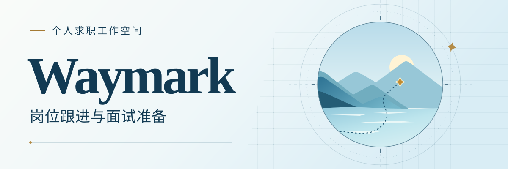
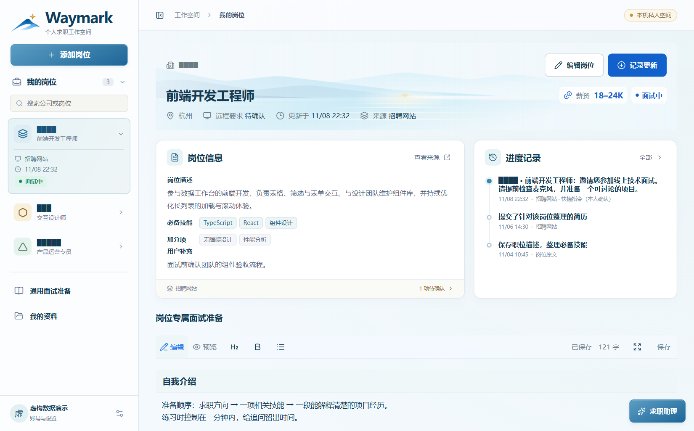
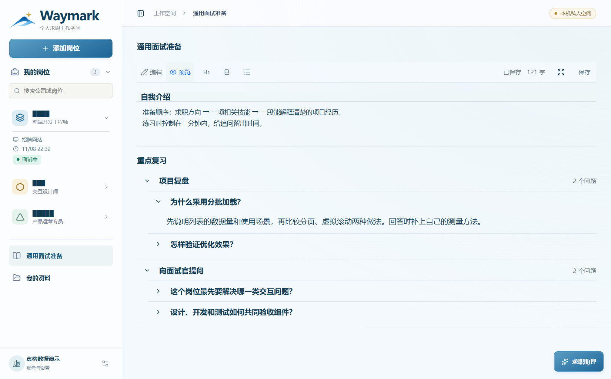
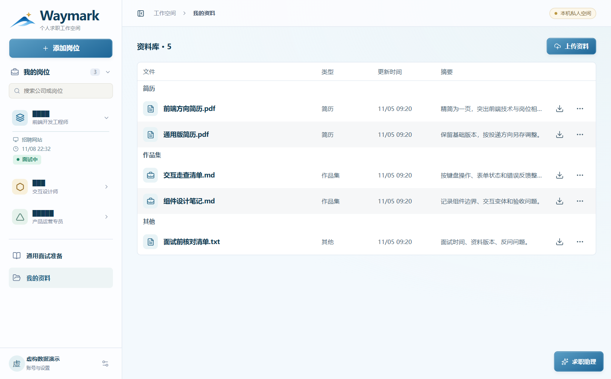
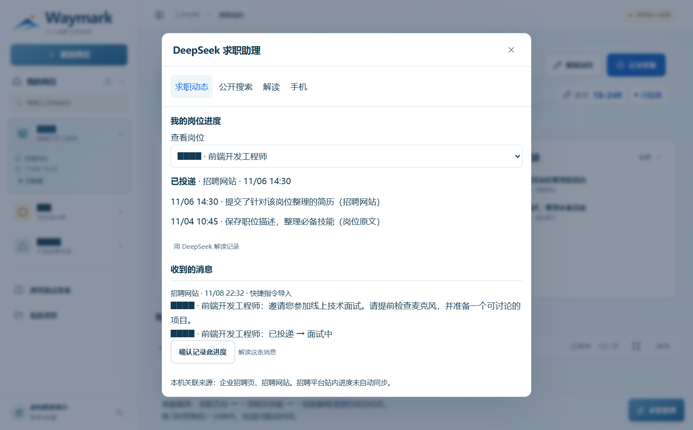

<p align="center">
  
</p>
<p align="center">
  
  
  
  
  
  
</p>

# Waymark 是什么？

收到面试邀请时，你可能想回头看看当时投的是哪个岗位，招聘原文里最看重什么，上一次沟通又谈到了哪里。**Waymark 是运行在自己电脑上的求职工作空间**。你可以从不同渠道收下岗位，把原文、进度和面试笔记放进同一份档案。同一家公司投了两个职位，也能分别跟进。

第一次打开先注册或登录，进入的是自己的空工作区。收录岗位、识别截图、写笔记和管理简历都可以在本机完成。想先试用，可以直接跳到[本地启动](#本地启动)。

以下四张图来自实际运行的 Waymark，使用独立演示数据。图中的公司名均以实心块代替。

## 从岗位原文开始

在左侧选择 **添加岗位**，关联招聘来源，再上传截图、粘贴文字、保存链接或手动填写。截图可拖入或从剪贴板粘贴，本机识别简体中文和英文。你可以对照原图检查识别出的字段，再确认保存。链接保留原地址，薪资、远程要求和投递状态缺少依据时显示「待确认」。

<p align="center"></p>

收到回复后，展开侧栏里的岗位就能看到平台、当前进度和更新时间。打开岗位可记录这次沟通的来源与内容，也能回看之前的变更。截图单张上限为 10 MB，一次最多新增 40 MB。[截图录入细节（英文）](docs/screenshot-intake.md)

## 为下一场面试做准备

自我介绍、经常被问到的技术问题，适合放在 **通用面试准备**。只针对某个职位的要求、面试官提出的问题和自己的复盘，则写进该岗位的专属笔记。正文可分节，复习题可按主题分组，每道题单独保存答案。长文可以放大编辑，返回后继续写同一份内容。

<p align="center"></p>

**我的资料**集中保存简历、证书和其他附件，可重命名、写摘要、预览、下载或删除。单个文件上限为 10 MB。PDF、DOCX、常见图片和文本可直接预览，遇到复杂排版可下载原件查看。

<p align="center"></p>

## 求职助理如何使用消息

打开右下角的 **求职助理**，可以查看本机进度和最近导入的消息。比如收到一条面试邀请，只有消息明确指向已关联的平台、公司、职位和阶段时，助理才会建议更新。你确认后，消息原文和来源会一起记入岗位历史。仅在 Waymark 里填写平台名称，不会获得读取该平台私人投递记录的权限。

<p align="center"></p>

| 操作 | 数据去向 |
| --- | --- |
| 收录岗位、识别截图、管理资料、匹配导入消息 | 由本机服务处理，核心功能无需 API 密钥。 |
| 点击「确认联网搜索」 | 将你确认的搜索词发给博查，返回公开网页。公开搜索结果不会写入个人投递进度。 |
| 点击「确认发送并解读」 | 将预览框里的摘录和任务说明发给 DeepSeek，最多 6,000 字。发送前可以删去联系方式或不想分享的段落。系统不会自动附上整份简历。 |
| 开启 iPhone 提醒 | 通过苹果推送服务发送通用提醒。锁屏提醒不包含公司、手机号或消息正文。 |

## 本地启动

准备好 Git 和支持 `docker compose up --wait` 的 Docker Compose。Windows 可使用 Docker Desktop 的 Linux 容器模式。首次构建会下载基础镜像、依赖和文字识别工具。如果已有项目目录，直接在该目录执行启动命令。

```powershell
git clone https://github.com/Annabelle0726/Waymark.git
cd Waymark
docker compose up -d --build --wait
```

打开 **[本机工作空间](http://127.0.0.1:4173)**，用昵称、手机号和密码注册。手机号是本机登录标识，当前未接入短信验证。默认仅本机可访问。网页和接口由同一个容器提供，SQLite 数据库及附件保存在电脑上。更改端口时，在根目录的本地 `.env` 中设置 `WAYMARK_PORT=4174` 后重新启动。

在原生 Linux 上，请先创建 `data/` 和 `private/`，确保容器用户（UID 1000）能写入数据目录，并能读取已配置的密钥文件。从只有邮箱的旧版本升级前，请先备份。没有手机号的旧账号需要单独处理迁移。

### 日常使用与更新

| 想做的事 | 在项目目录运行 |
| --- | --- |
| 暂停，再次启动 | `docker compose stop`，下次运行 `docker compose start` |
| 检查运行状态 | `docker compose ps` |
| 查看最近日志 | `docker compose logs --tail=80 app` |
| 获取并运行新版 | 先备份，然后依次运行 `git pull --ff-only` 和 `docker compose up -d --build --wait` |
| 移除容器并保留本机数据 | `docker compose down`，下次运行 `docker compose up -d --wait` |

### 配置联网功能（可选）

每台安装 Waymark 的电脑只需由维护者配置一次。普通用户无需在网页输入密钥。以下 PowerShell 命令只在本机配置文件尚不存在时复制空模板。

```powershell
New-Item -ItemType Directory -Force private | Out-Null
if (!(Test-Path private/backend.env)) { Copy-Item backend.env.example private/backend.env }
notepad private/backend.env
```

在文件中分别填写博查的 `BOCHA_API_KEY` 和 DeepSeek 的 `DEEPSEEK_API_KEY`。保存后运行 `docker compose restart app` 即可生效，无需重建镜像。真实配置放在 `private/backend.env`，仓库里只有[空白模板](backend.env.example)。

<details>
<summary><strong>在 iPhone 上导入招聘短信、接收提醒</strong></summary>

手机与电脑需处于可信局域网，电脑上的服务需持续运行。可选配置会在指定的电脑局域网地址开放 HTTPS 的 8443 端口。请使用稳定的局域网 IPv4 地址，仅允许专用网络访问该端口，并保持路由器端口转发关闭。

```powershell
$env:WAYMARK_LAN_IP = Read-Host "输入电脑的局域网 IPv4 地址"
docker compose -f compose.yaml -f compose.iphone.yaml up -d --wait
docker compose -f compose.yaml -f compose.iphone.yaml cp iphone:/data/caddy/pki/authorities/local/root.crt ./private/waymark-local-root.crt
```

1. 通过可信渠道把导出的**公开根证书**传到手机，安装描述文件，在「设置 → 通用 → 关于本机 → 证书信任设置」中启用信任。证书私钥保存在本机 Docker 的证书卷内。[苹果证书信任说明](https://support.apple.com/zh-cn/102390)
2. 在 iOS 16.4 或更高版本的 Safari 中打开 `https://电脑的局域网IP:8443`，添加到主屏幕，从新图标登录。进入「求职助理 → 手机」，点「启用本机推送」并允许通知。退出登录或会话过期后，需重新登录并启用。[主屏幕网页推送说明（英文）](https://webkit.org/blog/13878/web-push-for-web-apps-on-ios-and-ipados/)
3. 在岗位表单关联来源，再到助理的「手机」页生成配对码。新建接收共享文本的快捷指令，添加「获取 URL 内容」，向同一 HTTPS 地址的 `/api/mobile/intake` 发起 `POST`。请求头填写 `Authorization: Bearer <配对码>`，JSON 字段 `platform` 填已关联的平台名称，`text` 填选中的消息，最多 3,000 字。配对码只有导入权限，可随时撤销。
4. 指定发件人的招聘短信可用「信息」自动化转交快捷指令。仅出现在招聘应用内的消息，需要主动分享或复制。相同来源的相同文本默认去重，也可用稳定的 `eventId` 标识同一次事件。实际提醒受网络、系统权限和专注模式影响。

手机模式的更新继续使用这两份 Compose 文件。恢复到仅桌面访问时，在保留上述环境变量的终端执行以下命令。证书卷会保留。删除该卷后需为手机重新配置信任。停用这套安装时可移除手机上的证书描述文件。

```powershell
docker compose -f compose.yaml -f compose.iphone.yaml down
docker compose up -d --wait
```

</details>

<details>
<summary><strong>数据保存在哪里，如何备份和恢复</strong></summary>

默认数据库是宿主机的 `data/workspace.sqlite`，容器内对应 `/var/lib/waymark`。账号、会话、岗位、笔记、导入的消息和上传文件的原始内容都保存在数据库中。重建容器后继续挂载同一目录即可使用原数据。不同电脑之间需要手动迁移。拥有主机数据库或 Docker 管理权限的人可以读取本机资料。

**备份。** 先停止所有写入这个数据库的进程，包括本地开发服务。以下命令适用于默认目录。如果设置过 `WAYMARK_DATA_DIR`，请复制实际使用的目录。SQLite 运行中可能生成 `-wal`、`-shm` 文件，因此要复制整个数据目录。备份含私人资料和会话，请妥善保管，密钥另行保存。

```powershell
docker compose stop
$backupDir = Join-Path $env:USERPROFILE ("Waymark-Backups/" + (Get-Date -Format "yyyyMMdd-HHmmss"))
New-Item -ItemType Directory -Path $backupDir -Force | Out-Null
Copy-Item -LiteralPath ./data -Destination $backupDir -Recurse -ErrorAction Stop
docker compose start
```

**恢复。** 将备份复制到新目录，再让容器挂载该目录。这样可以保留原数据库。以下步骤适用于桌面配置。

```powershell
$backupDir = Read-Host "输入包含 data 文件夹的备份目录"
$restoreDir = Join-Path $env:LOCALAPPDATA ("Waymark-Restored/" + (Get-Date -Format "yyyyMMdd-HHmmss"))
if (!(Test-Path (Join-Path $backupDir "data/workspace.sqlite"))) { throw "备份中缺少数据库" }
New-Item -ItemType Directory -Path $restoreDir -ErrorAction Stop | Out-Null
Copy-Item -LiteralPath (Join-Path $backupDir "data") -Destination $restoreDir -Recurse -ErrorAction Stop
$env:WAYMARK_DATA_DIR = Join-Path $restoreDir "data"
docker compose up -d --force-recreate --wait
```

登录后核对岗位、笔记，并下载一个附件验证原件。要让恢复目录在下次打开终端时继续生效，在本地 `.env` 中设置 `WAYMARK_DATA_DIR=C:/实际路径/data`。在设置中删除账号会一并删除其数据。删除数据目录或用旧备份覆盖数据库也可能导致资料丢失。

</details>

<details>
<summary><strong>轻量开发与前端热更新</strong></summary>

安装 Node.js 24.14 或更高的 24.x 版本。在单独的开发数据目录运行以下命令，打开[开发工作空间](http://127.0.0.1:5173)。修改 React 或样式后可在浏览器查看更新。

```powershell
$env:WAYMARK_DATA = Join-Path $env:LOCALAPPDATA "Waymark-dev/data"
npm ci
npm run dev
```

运行 `npm run build` 做类型检查并生成前端产物，`npm start` 可提供构建后的网页。原生开发环境要使用截图识别，需安装 Tesseract 及 `chi_sim`、`eng` 语言包。Docker 版本已包含这些依赖。

</details>
